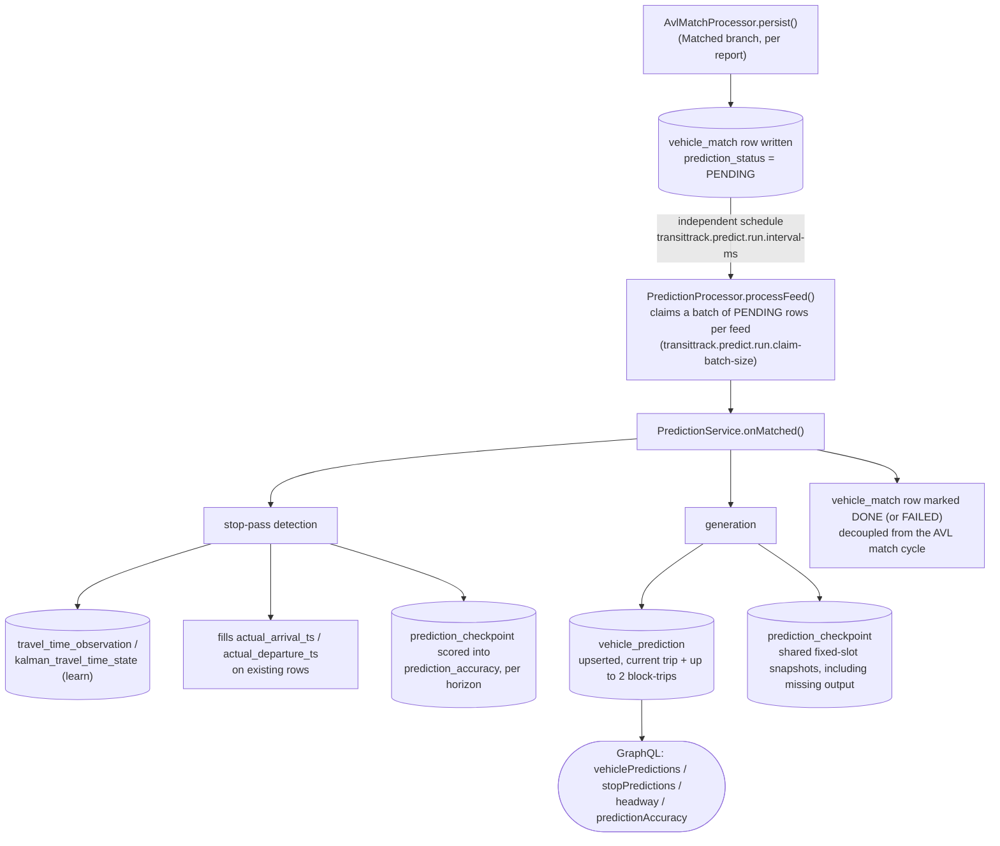

# Prediction generation

This subsystem (`eu.transittrack.predict`) computes per-stop arrival/departure
**predictions** for every AVL-matched vehicle, tracks their accuracy against
what actually happened, and exposes both — plus a derived route-level
headway/wait-time view — over a Spring GraphQL read API.

Schema migrations: `src/main/resources/db/changelog/0003-predict.yaml`, reshaped
by 0010/0012/0015/0016/0017 (feed-code keys, sequences, pattern keys, learning
buckets), 0018/0019 (claim index, accuracy horizons), and 0020 (source freshness,
crossing quality, persistent frequency runs and shared accuracy snapshots).
Builds directly on top of the AVL subsystem — see [`docs/avl.md`](avl.md) first.

---

## 1. Overview



Prediction generation runs on its **own independent scheduler**,
`PredictionProcessor`, decoupled from `AvlMatchProcessor`. Every successful
AVL match writes exactly one `vehicle_match` row with `prediction_status =
PENDING`; `PredictionProcessor` polls each enabled feed on its own cadence
(`transittrack.predict.run.interval-ms`, default 5000ms), claims a batch of
that feed's PENDING rows (`transittrack.predict.run.claim-batch-size`, default
500), dispatches each to `PredictionService.onMatched` in order, and marks
each row `DONE` or `FAILED`. A feed with a large backlog just takes longer to
drain, or drains across several cycles — nothing is silently dropped under
load, unlike the fixed-capacity executor this replaces. Predictions are a true
no-op when `transittrack.predict.enabled = false`: `PredictionProcessor` isn't
even registered as a bean, and PENDING rows simply accumulate unprocessed in
`vehicle_match` (see the `transittrack.prediction.pending.matches` gauge).

Three pluggable algorithms compute an ETA for each stop path ahead of a
vehicle:

| Algorithm | Basis |
| --- | --- |
| `SCHEDULE_ADHERENCE` | scheduled arrival time, shifted by the vehicle's current `scheduleAdherenceSec`; early running is absorbed at a trip's first stop, lateness by the layover before the next block trip. Stops at the first frequency-based trip of the horizon (§4) |
| `HISTORICAL_AVERAGE` | a windowed running mean of observed stop-to-stop times per pattern, stop path and day-type/time-band bucket, accumulated stop by stop from the vehicle's current position |
| `KALMAN` | a scalar Kalman filter over the same observations, same accumulation, plus a `confidenceSec` (§3) |

Each `avl_feed` lists the algorithms to run (`predictionAlgorithms`, default
`[SCHEDULE_ADHERENCE]`). Every listed algorithm writes its own
`vehicle_prediction` row per stop and is scored for accuracy, so listing more
than one compares them side by side. The **first** listed algorithm is the
feed's designated one: `stopPredictions` and `headway` (§6) use it when no
`algorithm` argument is given, so multiple algorithms' rows for the same
vehicle never double-count.

Strategies run **before** the write transaction opens, each isolated from the
others: one failing strategy neither drops the other algorithms' predictions
nor rolls back the stop passes and learning of the same report. Its failure is
rethrown once everything else is committed, so the `vehicle_match` row is still
marked `FAILED`.

Generation requires a source report no older than `run.max-source-age-sec`
(default 600). A backlog is still processed for crossings and learning, but
reprocessing old GPS data does not turn it into a live forecast. Source report
time, GTFS service date and processing time are stored separately.

---

## 2. Configuration

The whole tree is under `transittrack.predict`. The configuration class defaults
to `enabled: false`, but the shipped `application.yaml` explicitly enables it.
Setting it to `false` disables generation and prediction housekeeping; the read
API remains available for stored data.

```yaml
transittrack:
  feed:
    feeds:
      - code: mbta
        # ...GTFS fields (see docs/gtfs.md)...
        avl:
          # ...AVL fields (see docs/avl.md)...
          prediction-algorithms: [ SCHEDULE_ADHERENCE, KALMAN ]   # first one is the feed's designated algorithm
  predict:
    enabled: true
    run:
      interval-ms: 5000                            # PredictionProcessor's own poll cadence, independent of avl.match.match-interval-ms
      claim-batch-size: 500
      prediction-min-change-sec: 10                # an open prediction moving less than this is not rewritten...
      prediction-refresh-sec: 120                  # ...unless its computed_at is older than this
      max-source-age-sec: 600                      # generation and live reads use source GPS age; refresh must be below this
    learn:
      max-plausible-travel-time-sec: 1800          # samples outside (0, this] are discarded, not learned from
      kalman-measurement-noise-sec2: 400.0         # ~20s std-dev of a single observation
      kalman-initial-variance-sec2: 3600.0         # ~60s std-dev before any observation
      kalman-process-noise-sec2: 25.0              # drift allowed per sample; keeps the gain from decaying to zero
      kalman-variance-growth-sec2-per-hour: 400.0  # additional uncertainty while evidence ages
      max-reliable-report-gap-sec: 120            # longer GPS intervals still record actuals, but aren't trusted labels
      history-window: 50                           # past this many samples each new one weighs 1/window
      history-prior-samples: 5                     # the schedule seed counts as this many samples in the average
      outlier-min-deviation-sec: 60.0              # a sample is clipped to estimate ± max(this,
      outlier-max-relative-deviation: 1.0          #   this × estimate) before either learner takes it in
      min-bucket-samples: 10                       # a bucket is trusted over its roll-up from this many samples
    accuracy:
      horizons-sec: [ 60, 180, 300, 600, 900, 1200, 1800 ]   # actual lead-time upper bounds (§5)
      sample-interval-sec: 60                      # shared source-report slots, independent of each algorithm's ETA
    retention:
      prediction-hours: 6
      accuracy-days: 30
      raw-crossing-days: 90
      sweep-cron: "0 15 * * * *"                   # hourly, offset from the AVL sweep
```

`prediction-algorithms` is a per-feed field on the nested `avl` block of
`transittrack.feed.feeds[]` (`FeedsProperties.AvlDef`), not under
`transittrack.predict` — mirroring how `assignment-mode` already works.

---

## 3. The learning loop

**Stop-pass detection** runs first, inside `PredictionService.onMatched`,
before any prediction is (re)generated:

- Fires only when the new match is on the **same trip** as the vehicle's
  previous match and has moved forward along it — a block-advance or
  re-assignment produces no pass.
- Stop `k` sits at the **end** of stop path `k`. It is passed once the
  vehicle's along-trip distance moves from before it to at/after it; the pass
  time is interpolated linearly by distance between the two reports. The
  first stop (stop path 0, zero-length) is "passed" when the vehicle **leaves**
  it, i.e. moves beyond `FIRST_STOP_RADIUS_M` (30 m) of the trip start; its
  pass time is the midpoint of the interval. The last stop counts as reached
  `LAST_STOP_RADIUS_M` (30 m) before the end of the trip (no closer than
  halfway along its stop path), since a vehicle laying over at the terminus
  usually reports just short of the shape's end. Once reached, the next
  prediction run no longer predicts it.
- Each pass is appended to `avl_stop_crossing` (also the optimizer's input).
  GPS jitter carrying a vehicle across the same stop twice counts once: a stop
  already passed within the current service day/run and
  `max-plausible-travel-time-sec` is skipped.
- A pass whose previous stop on the same trip was also passed yields one
  **stop-to-stop sample**: the time from passing stop `k-1` to reaching stop
  `k` (so it includes the dwell at `k-1`). A sample outside
  `(0, learn.max-plausible-travel-time-sec]` is not learned from, nor is one
  whose two stops were passed between the **same** two reports: both pass
  times are interpolated over one interval, so the "sample" would only echo
  the uniform-speed assumption (the passes are still recorded and fill
  actuals).
- `report_gap_sec` records the report interval, rounded **up** to whole seconds.
  A gap above `learn.max-reliable-report-gap-sec` marks the actual unreliable.
  Learning requires reliable intervals at **both** endpoints; a reliable new
  crossing cannot rehabilitate an unreliable or legacy unknown endpoint.
  Unreliable actuals remain visible, but their checkpoints are discarded without
  accuracy scoring. `transittrack.prediction.crossings.unreliable` counts them.
- Every pass fills `actual_arrival_ts` (`actual_departure_ts` for stop 0) on
  the vehicle's `vehicle_prediction` rows for that stop, and scores its
  accuracy checkpoints (§5).

**Keys and buckets.** Both learners are keyed by
`(gtfs_feed_code, pattern_key, stop_path_index, day_type, time_band)`.
`pattern_key` is the pattern's stable key (route, shape, stop list), so
learning survives GTFS revision swaps that keep a pattern. The bucket is the
day type (`WEEKDAY`/`SATURDAY`/`SUNDAY`) and service-day time band (`NIGHT`,
`MORNING_PEAK` 06–09, `MIDDAY` 09–15, `AFTERNOON_PEAK` 15–19, `EVENING` 19–24)
of the moment the vehicle **left the previous stop**. Each sample updates its
bucket plus two roll-ups — the whole day type (`time_band = ALL`) and
everything (`ALL`/`ALL`). Predictions look a stop path up the same way and fall
back to the coarser roll-up while a bucket has fewer than
`learn.min-bucket-samples` samples.

**Outlier clipping.** Before either learner takes a sample in, it is clipped
to `estimate ± max(outlier-min-deviation-sec, outlier-max-relative-deviation × estimate)`:
a bus held 20 minutes at a stop moves the estimate a little rather than by
minutes, while a lasting change (road works, a detour) still gets through over
a few samples. The very first sample of a bucket is never clipped — the
schedule seed it would be measured against is no learned value.

**Running average** (`travel_time_observation`):
`mean += (sample - mean) / min(sampleCount + history-prior-samples, history-window)`.
The schedule seed counts as `history-prior-samples` samples, so the first few
observations blend with it rather than the first one replacing it; past the
window each new sample keeps weight `1/history-window`, so the mean keeps
tracking changing conditions.

**Kalman filter** (`kalman_travel_time_state`), a scalar filter on the
travel-time value itself:

```
agedVariance = errorVariance + max(0, evidenceAgeHours) * varianceGrowthPerHour
prior = agedVariance + processNoise         // no process noise on the first sample
gain = prior / (prior + measurementNoise)
estimateSec += gain * (clippedSample - estimateSec)
errorVariance = prior * measurementNoise / (prior + measurementNoise)
```

With the defaults the gain settles around 0.2.

A `KALMAN` prediction's `confidenceSec` is an estimated **one-standard-deviation
spread**, not a confidence percentage. Each learned leg contributes its state
variance, measurement noise and elapsed-evidence-age variance. An unlearned
schedule-fallback leg contributes `initialVariance + measurementNoise` (4000
sec² by default), rather than silently adding zero uncertainty. A partial leg's
variance scales by `remainingFraction²`; independent-leg variances accumulate.
The defaults are conservative modeling assumptions, not empirically calibrated
production values; §5 exposes their observed coverage.

Both learners are **seeded from the schedule-derived stop-to-stop time**
(`travel_times_for_stop_path` travel time plus the dwell at the previous stop)
when a bucket has no row yet — the Kalman state starts there with
`learn.kalman-initial-variance-sec2` — so `HISTORICAL_AVERAGE`/`KALMAN`
predictions are sane from the very first match.

**Consistency.** All reads and writes of one report go through a single
`StatelessSession` transaction. Learner rows are read with `SELECT ... FOR UPDATE`
in a fixed order (stop path ascending, then fine to coarse bucket, observation
before Kalman state). A transaction-scoped advisory lock per GTFS feed/pattern
also protects initialization when there is no row to lock yet. Concurrent first
samples are therefore retained without inserting artificial seed observations.
Learner freshness uses the newest source evidence timestamp, not processing time,
and older samples cannot move that timestamp backwards.

**Batching.** A report's writes are batched rather than issued row by row: one
locking `SELECT` per learner table for every bucket the report's samples touch,
then one JDBC batch of upserts per table; one batch each for crossings,
predictions, checkpoints and accuracy rows; and one `UPDATE` filling every
passed stop's actuals. Schedule seeds (`travel_times_for_stop_path`) are read
through the `avlTravelTimes` cache, one map per pattern and revision.

Learner rows whose `pattern_key` no revision of their GTFS feed still has are
reclaimed by the retention scheduler's orphan sweep (§7).

---

## 4. The merged stop-time model

One `vehicle_prediction` row per `(feed_code, vehicle_id, trip_row_id,
stop_path_index, algorithm)`, upserted in place (native
`INSERT ... ON CONFLICT ... DO UPDATE`, same pattern as `AvlWriter.upsertState`):

- **Created on first match** for the vehicle's current trip (stop paths from
  its current position through the end of the trip) plus up to its next **2
  block-trips** (fewer than 2 remain in the block → predict as many as
  exist). A flagged deadhead transition ends the horizon: there is no modeled
  transfer duration to support a forecast across it. Stop paths before the vehicle was first observed on the trip never
  get a row — there's nothing to predict (already past) and nothing to
  backfill as actual (the vehicle wasn't tracked yet).
- **The same row later gets `actual_arrival_ts`/`actual_departure_ts` filled
  in** by stop-pass detection (§3) once the vehicle passes that stop —
  `predicted_*`/`algorithm` are left untouched, so the row keeps both "what we
  predicted" and "what actually happened" for that one stop, which is what
  makes accuracy tracking (§5) possible and gives `StopPrediction` its merged
  view: scheduled (resolved live from `schedule_time`, not stored) + actual +
  predicted, in one row.
- A row that just got an actual filled in is no longer forward-looking, so
  `stopPredictions`/headway (§6) exclude it — only rows with
  `predicted_arrival_ts != null && actual_arrival_ts == null && actual_departure_ts == null` count for those
  reads. (`vehiclePredictions` has no such filter — it shows the full trip
  history including already-crossed stops.)
- **A row with an actual is not overwritten** by later prediction runs (a
  vehicle jittering back before a stop it passed would otherwise wipe the
  pass). A different persisted `service_date` resets the row and its actuals
  immediately; expiry remains a fallback for older rows without that date.
  Older source reports cannot overwrite newer predictions or delete their
  remaining horizon.
- **An open row is only rewritten when it changed**: its block or pattern
  changed, a predicted time appeared or disappeared, or a predicted time moved
  by at least `run.prediction-min-change-sec` — or its `computed_at` is older
  than `run.prediction-refresh-sec`, refreshing its source evidence. Live readers
  use `source_report_ts` against `run.max-source-age-sec`, never `computed_at`.
  This spares most rows the write a
  vehicle's every report would otherwise cost.

Learned arrival-to-arrival duration is split into travel and preceding dwell in
the schedule's proportions. The previous departure and next arrival use that
same split, so a shortened learned leg cannot put departure after the following
arrival. Future block-trip metadata survives omission of a reached terminal,
allowing the next trip's scheduled layover to absorb previous lateness.

**Frequency-based trips** (GTFS `frequencies.txt`) have no clock times, so
`SCHEDULE_ADHERENCE` predicts none of their stops (nor anything after them in
the horizon), and the learned algorithms don't hold a vehicle at their first
stop until a scheduled departure. A frequency trip runs as repeated laps on
the same trip row. `prediction_frequency_run` persists the current service date,
run boundary, descriptor departure and latest report/distance per feed/vehicle/trip,
so returning after another assignment does not reload the old lap.
A changed service date/descriptor departure or recognized backwards reset starts
a new run **before its first crossing**. Previous predictions and pending
checkpoints are cleared, while historical crossings remain intact and are
excluded from current-run learning. Matching still has the limitation in §9.

---

## 5. Accuracy tracking

Scoring only a stop's latest prediction — refreshed on every match until the
vehicle gets there — would measure predictions made seconds before arrival,
which every algorithm gets nearly right. Accuracy is therefore sampled at
fixed shared snapshots, then grouped into **actual lead-time horizons**
(`accuracy.horizons-sec`, default 1, 3, 5, 10, 15, 20 and 30 minutes):

1. **Capture.** Source report time is rounded down to
   `accuracy.sample-interval-sec` (default 60 seconds). The first report cohort
   in each slot is retained for every horizon target and configured algorithm.
   Missing output, including strategy failure, is an explicit null forecast.
   Later reports cannot fill a cohort with different source/production times.
   Already-passed stops get no new snapshot.
2. **Timestamp.** `computed_at` on a checkpoint is its source report time;
   `produced_at` is captured just before persistence, after generation and
   crossing/learner locking. Source freshness is checked again there.
3. **Score.** At a reliable crossing, lead is `actual − produced_at`, never
   `predicted − report`. Snapshots from another service date, issued after the
   crossing, or beyond the longest horizon are excluded. In each non-overlapping
   lead-time bin, the earliest issued cohort supplies **all** algorithms'
   results. Stop 0 uses departure; other stops use arrival. Consumed checkpoints
   are deleted. Accuracy retains source time as `predicted_at` and issuance time
   separately as `produced_at`:

```
error_sec = actual − predicted     // positive = the vehicle got there later than predicted
```

Missing output has null prediction/error fields, not fabricated zero error.
Snapshots older than the longest scored lead plus one sample interval are
pruned as new ones are captured; retention also removes abandoned checkpoints.

`predictionAccuracy` compares the feed's configured algorithms by default, or
one explicitly requested algorithm. Cohorts must contain a recorded outcome
for every compared algorithm at identical source/production times. `eligibleCount`
is that denominator; `sampleCount` and `predictionCoverage` show available
forecasts. MAE, signed error and P90/P95 use **only fully paired cohorts**,
reported as `pairedSampleCount`. Unavailable comparisons return null error
statistics. Overall percentiles pool raw paired errors across horizons; they
are not averages of horizon percentiles.

`byHorizon` separates near-term and longer-range performance. Optional route,
direction, day-type and source-observation-time-band filters allow contextual
comparisons. `confidenceCoverage` measures the fraction of available forecasts
whose absolute error is within their estimated one-SD spread;
`confidenceSampleCount` gives that separate denominator.

Migration 0020 clears only old **unscored checkpoints**. Scored history remains
stored (and usable as raw optimizer evidence), but legacy ETA-selected rows are
excluded from the new comparison because they lack actual-lead/issuance markers.
Comparable summaries therefore refill from newly observed crossings. The
`transittrack.prediction.error` / `.absolute.error` metrics are tagged only by
`feed` and `algorithm` (pooling every horizon) to keep their cardinality flat;
use `byHorizon` for the per-horizon breakdown.

---

## 6. Headway / wait time

`HeadwayReadService` is a **read-time aggregation** over live
`vehicle_prediction` rows — no new learning, no new storage. For a given
`(feedCode, stopId, routeId, directionId)`:

1. Resolve the `stop_path_index` that `stopId` sits at in that route+direction's
   pattern(s), then collect every forward-looking `vehicle_prediction` row at
   that index (across every currently-matched vehicle on that route+direction),
   filtered to the requested algorithm (default: the feed's first listed one), ordered by
   predicted arrival.
2. **Wait time** (`waitSec`) = time from now until the soonest arrival in that
   list.
3. **Gaps** (`gapsSec`) = consecutive differences between arrivals — empty
   when fewer than two vehicles are currently approaching that stop.
4. **Scheduled headway** (`scheduledHeadwaySec`) = the **average** gap
   between the trips of the pattern(s) scheduled at that stop from one hour
   before the first predicted arrival to one hour after the last (now ± 1 h
   when nothing is predicted), counting only trips whose service runs on that
   day (the previous service day too, for times past 24:00). Frequency-based
   trips have no clock times and are left out. `null` when fewer than two
   trips fall in the window.

If this live join doesn't scale, the design flags a materialized headway
snapshot table as the natural next step — not built preemptively.

---

## 7. Retention

`PredictionRetentionScheduler` (`@ConditionalOnProperty("transittrack.predict.enabled", "true")`)
runs on `retention.sweep-cron` (hourly, offset from the AVL sweep):

| Table | Pruned when | Note |
| --- | --- | --- |
| `vehicle_prediction` | `computed_at` older than `retention.prediction-hours` (default 6h) | predictions go stale fast |
| `prediction_checkpoint` | `computed_at` older than `retention.prediction-hours` | never scored: the vehicle didn't reach (or wasn't seen passing) the stop |
| `prediction_frequency_run` | `last_report_ts` older than `retention.prediction-hours` | idle run state; raw crossing history is retained independently |
| `prediction_accuracy` | `created_at` older than `retention.accuracy-days` (default 30d) | kept far longer — this is what an operator reviews to pick an algorithm |
| `avl_stop_crossing` | `observed_at` older than `retention.raw-crossing-days` (default 90d) | raw passes, input to schedule optimization |
| `travel_time_observation` | no stored revision of its GTFS feed has a pattern with its `pattern_key` | orphan sweep; a revision swap that keeps a pattern keeps its learning |
| `kalman_travel_time_state` | same | same orphan sweep |

---

## 8. GraphQL read API

```graphql
vehiclePredictions(feedCode: String!, vehicleId: String!, algorithm: PredictionAlgorithm): [StopPrediction!]!
stopPredictions(feedCode: String!, stopId: String!, routeId: String, directionId: Int, algorithm: PredictionAlgorithm): [StopPrediction!]!
headway(feedCode: String!, stopId: String!, routeId: String!, directionId: Int, algorithm: PredictionAlgorithm): Headway!
predictionAccuracy(feedCode: String!, algorithm: PredictionAlgorithm, sinceDays: Int = 7,
  routeId: String, directionId: Int, dayType: PredictionDayType, timeBand: PredictionTimeBand): [PredictionAccuracySummary!]!
```

- `vehiclePredictions` — every `vehicle_prediction` row for that vehicle's
  current trip (as recorded on `vehicle_state`), ordered by `stopPathIndex`,
  including already-crossed stops; one `StopPrediction` per
  `(stopPathIndex, algorithm)` unless `algorithm` is given.
- `stopPredictions` — one row per trip still approaching a given stop (a
  rider-facing "next arrivals" list; the finer-grained input `headway`
  aggregates), restricted to the requested AVL feed. A trip predicted by two
  vehicles at once (the one running it, and one with it later in its block)
  counts once: the vehicle actually on the trip wins, otherwise the most
  recent source report. The deduplicated result is explicitly ordered by arrival.
- `headway` — see §6.
- `predictionAccuracy` — see §5. Summary and horizon rows expose availability,
  paired sample counts, nullable error/percentile metrics and one-SD coverage.
- `StopPrediction` includes `sourceReportTs`, `actualReportGapSec` and
  `actualReliable`. The vehicle timeline uses departure for stop 0 and warns on
  unreliable actuals. Its default algorithm follows feed configuration, not
  an unqualified global-MAE ranking.

```graphql
{
  vehiclePredictions(feedCode: "mbta-vp", vehicleId: "bus-1") {
    stopPathIndex predictedArrival algorithm actualArrival
    stop { stopId }
  }
}
```

---

## 9. Known limitations

1. **Learned state resets when a pattern changes** — a new route, shape or stop
   list gives the pattern a new `pattern_key`, and its learning starts again
   from the schedule seed.
2. **Stop passes between two reports are interpolated** at uniform
   speed. Samples between stops passed in the same interval are dropped (§3),
   and excessive gaps are excluded, but accepted endpoints remain approximate.
   Empirical uncertainty calibration and correlated-leg modeling are not yet
   implemented.
3. **Outlier clipping biases skewed travel times slightly low**: the long
   tail of genuinely slow trips is clipped together with true outliers.
4. **A frequency trip's next lap may require a matching gap/reassignment.**
   The AVL matchers never match a vehicle backwards along the trip it is
   already on, so a vehicle looping straight back to the start of the same
   frequency trip stays matched near the end until it is unmatched or matched
   to another trip; only then does the new lap reset (§4).

Deferred entirely (see the design spec, §1/§12): emitting GTFS-RT `TripUpdate`
from these predictions, and a materialized headway snapshot table (only
needed if the live aggregation in §6 proves too slow at scale).

See also: [docs/avl.md](avl.md), [docs/gtfs.md](gtfs.md), [docs/schedule.md](schedule.md).
